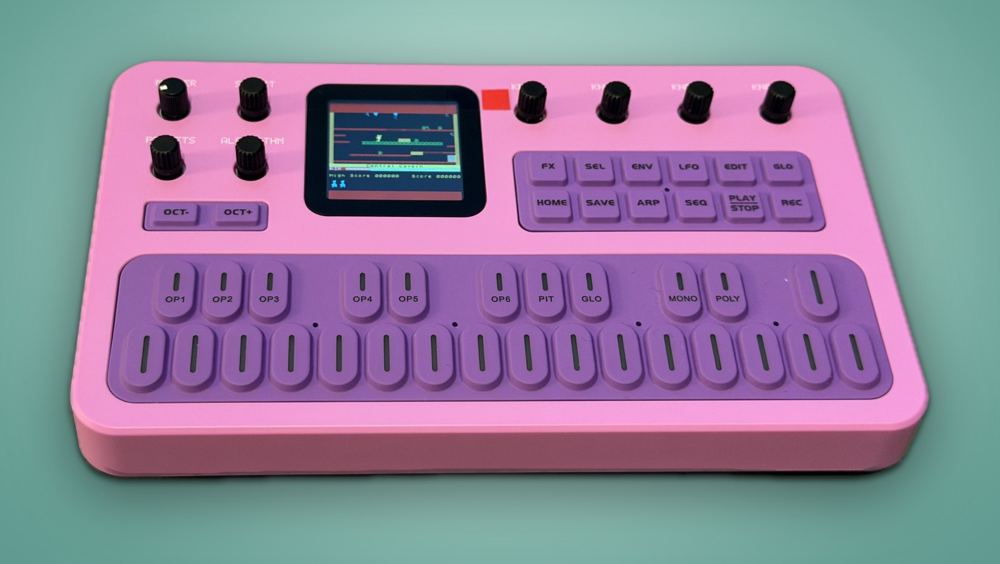
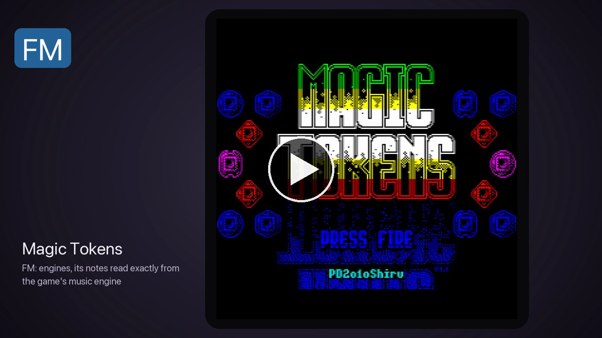
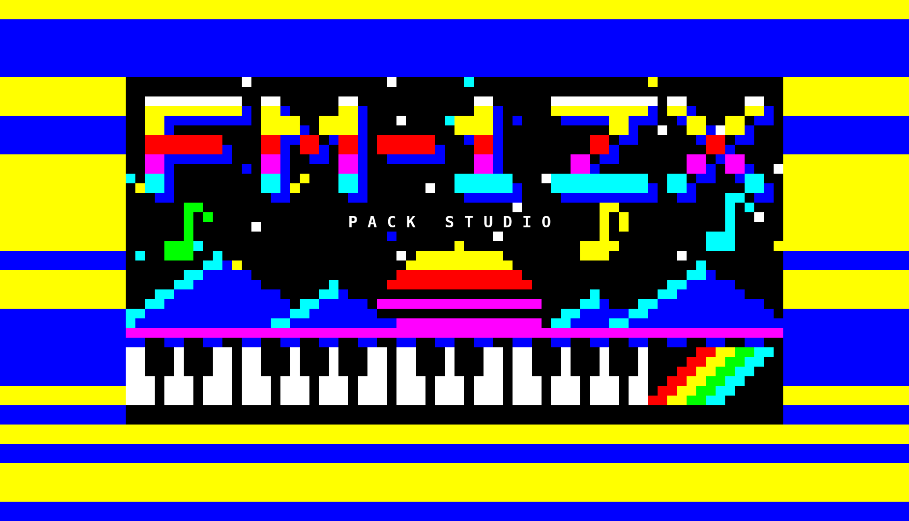
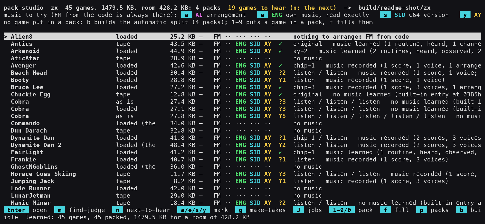

<!-- SPDX-FileCopyrightText: 2026 FM-1 ZX contributors -->
<!-- SPDX-License-Identifier: GPL-3.0-or-later -->

# FM-1 ZX

Something crazy and impractical: an open-source ZX Spectrum 48K emulator that runs as the firmware
of the M-VAVE FM-1 synth.

You play games with the synth's keys and knobs. The emulator also goes a step beyond the original
machine: it spots the instructions that drive the Spectrum's beeper and replaces those sounds, in
real time, with FM-synthesised instruments. It boots on the real hardware.

 
<a href="https://youtu.be/Is4KYSKhlqY">Watch the demo video</a>

**Try it in your browser: <https://dev-gh.nisdom.com/fm1-zx/>**, with a set of freely licensed
Spectrum games whose title tunes play as FM instruments (the computer keyboard plays the FM-1's
keys; the page lists them). Or build a
package of your own games with `tools/pack-studio` ([your own games](BUILDING.md#your-own-games)),
to run on the FM-1 or in a local copy of the browser page; it stays on your computer.

The firmware is C for the FM-1's pi32v2 CPU; the tests, the pack builder and every host tool are
Rust.

## Why

The FM-1 is a small, inexpensive FM synth that quickly became a favourite to reprogram, with a
lively scene of community firmwares. Its look and feel took me straight back to the ZX Spectrum 48K
I had as a kid: rubbery, wobbly keys and all. Its screen is so tiny you'll need a magnifying glass,
but it puts the beloved home computer on a pocket-sized synth, so who's complaining?

## How it was made

I built it with a little help from AI coding assistants, standing on the shoulders of existing
open-source work:

- [redcode/Z80](https://github.com/redcode/Z80), Manuel Sainz de Baranda y Goñi's emulator of
  Zilog's Z80 CPU, with Sofía Ortega Sosa's Z80InsnClock for its instruction timing;
- [Felucca](https://github.com/hugelton/Felucca) by Leo Kuroshita (Hügelton Instruments): the
  FM-1 hardware headers, the update loader and the package tools the firmware and its packages
  build on;
- Joakim Eriksson's [fm1-emu](https://github.com/joakimeriksson/fm1-emu), the FM-1 emulator every
  firmware test and the browser demo run in;
- three files of JieLi's AC79 SDK, the Spectrum 48K ROM (with Amstrad's permission) and freely
  licensed games by their authors.

[LICENSING.md](LICENSING.md) lists every component with its licence.

## Status

**FM-1 ZX runs on the real FM-1 and is tested on it**: it installs with M-Flasher and over USB from
the FM-1 Firmware Hub, boots to the game picker, plays the games with the FM-1's keys and knobs and
keeps a saved game across power-off and updates ([device test](docs/hardware-test.md)).
Installing custom firmware is at your own risk; [install and recovery](docs/install.md) describes
the way back to the stock firmware.

What works:

- a game picker, a HOME menu (resume, reset, on-screen Spectrum keyboard, the key map, LCD speed,
  sound, screen, back to games) and pause;
- one saved game: pausing with PLAY or leaving a game with HOME saves it, also across power-off;
  the picker marks that game, and Resume brings it back paused ([controls](docs/controls.md));
  an update of FM-1 ZX keeps the save, installing another firmware may overwrite it
  ([save format](docs/save-format.md));
- four screen modes in the HOME menu's Screen item: Crop (240 of the 256 columns),
  Fit and Fit smooth (all 256 columns, sharp or blended; Fit smooth is the default) and Border (the whole picture with a thin
  border, scaled down);
- built-in games: freely licensed Spectrum games (Castaway, Escape from Colony 8, Black Star, Micro
  INC, Magic Tokens) and test programs, each with its own mapping of the FM-1's notes, buttons and encoders to Spectrum keys or a
  Kempston joystick ([controls](docs/controls.md));
- FM music from the beeper, chosen in the HOME menu's Sound item (both with a 60 ms delay):
  - FM: engines (the default) recognises a game's music routine by its code, reads the notes from
    the game's memory and registers, checks them against the beeper's edges and plays them as FM.
    It knows some routines built in (Castaway, Colony 8, BASIC `BEEP` and three routines of games outside the repository); for
    your own games the pack builder learns each game's routine from its code
    ([the music](BUILDING.md#your-own-games)), and the built-in pack carries its games' learned
    music, Black Star's and Magic Tokens' tunes read exactly from their engines
    ([the built-in games' music](BUILDING.md#the-built-in-games-music));
  - FM: sound guesses the notes from the beeper's edges alone, where it can be sure of them;
  - each voice plays an instrument by its part in the tune: bass, lead or pad (stored at pack
    build, or worked out live from the pitches; `[game.instruments]` overrides it);
  - where FM cannot vouch for the notes (a routine it does not know) the original beeper plays (with
    Effects: Beeper; with Effects: FM the follower below plays it);
  - in FM: engines the sound effects play as FM too (a tone follows the beeper's pitch, with ticks
    and brief noise); the Effects row under Sound (FM or Beeper) turns that off. Frames the follower
    cannot follow (two voices mixed, very busy or sustained irregular sound (3 frames or more; a frame or two plays
    FM noise), or a brief 1-2 frame rejection inside a known tune) stay on the beeper;
- the Spectrum at its own speed (50 frames a second) with beeper sound, paced by the audio, and
  the screen sent to the LCD by changed rows: 50 display frames a second at LCD divider 1;
- an update package (`.fwsc`) with felucca-bsp's update loader, and a preview package to try in
  fm1-emu's web page ([install and recovery](docs/install.md)); the page (`tools/web-demo`) adds a
  guide, labels on the FM-1 drawing and computer keys that follow the running game's key map
  ([computer keyboard](docs/controls.md#computer-keyboard-browser-page));
- your own 48K games: `tools/pack-studio`, a terminal screen, builds the packages from a folder
  of them, turbo and custom-loader tapes included (loaded through the tape signal on the host):
  it learns each game's music, shows each game's size and which pack it goes in, and plays every
  candidate for a tune before you choose one ([your own games](BUILDING.md#your-own-games));
- a game's own music read exactly: where a game plays its tune through a beeper engine the
  studio knows (ntropic, Tritone, Stocker), it reads every note and drum from the engine as the
  game plays it and offers that as a take, which the judge prefers to the transcribed tune
  ([the game's own music, read exactly](BUILDING.md#the-games-own-music-read-exactly));
- music from a game's other versions: the studio finds the game's Commodore 64 and Spectrum 128
  music in the public collections, converts it to the FM-1's voices, and a judge ranks the
  candidates by how close they are to the game's own tune and how well they are written
  (polyphony, harmony, rhythm section), chooses where it is sure and marks the tunes left for
  your ear ([music from other versions](BUILDING.md#music-from-other-versions)); an optional tool
  has a music model write a bass, chords and drums around a recorded tune
  ([arranged music](BUILDING.md#arranged-music));
- the UBOOT gesture: OCT- held at power-on calls the boot loader's update-mode entry
  (`fmzx_enter_uboot`); behind M-VAVE's stock bootloader the computer then sees the boot loader on
  USB ([install and recovery](docs/install.md)).

Installing and updating over USB, from FM-1 ZX itself (a USB-MIDI device named `FM-1 ZX` whenever
the cable is in), tested on the FM-1: the FM-1 Firmware Hub finds it and installs other firmwares
from it, and a local installer installs a new package over it, an interrupted install resuming
([install and recovery](docs/install.md)).

Not supported: adding games without a new package, tapes played on the device itself.

## Build and test

See [BUILDING.md](BUILDING.md). In short, from the repository root:

    tools/fetch-test-data                                         # once
    tools/fm1-docker cmake --preset fm1 && tools/fm1-docker cmake --build --preset fm1
    cd host && FMZX_FM1_BUILD=$PWD/../build/fm1 cargo test --release --workspace

    tools/make-packages                                           # build/fm1/fmzx.fwsc, fmzx-preview.fwsc
    tools/web-demo                                                # the release package in fm1-emu's web page

## The tools, by example

Each tool prints its usage when run without arguments or with `--help`; BUILDING.md has the detail.

The studio opens on a start screen, a game's loading screen in ZX pixels, then lists the games
with their sizes, packs and music, and marks the tunes left for your ear:

Your own games (`W` is the workspace, `build/studio/<folder name>/`):

    tools/pack-studio ~/games                                     # the studio screen: sizes, packs, listen, choose
    tools/pack-studio ~/games --status                            # the games, their music and choices, as text
    tools/pack-studio ~/games --auto                              # read the games' own music, find C64 and Spectrum 128 music, judge, choose where sure
    tools/pack-studio ~/games --generate eng                      # the games' own music, read exactly from their engines
    tools/pack-studio ~/games --auto --game some-game             # the same for one game (--status lists the ids)
    tools/pack-studio ~/games --generate ai --game some-game      # a music model's takes for one game
    tools/pack-studio ~/games --assign some-game=2 --auto-fill    # put a game in pack 2, fill the packs with the rest
    tools/pack-studio ~/games --build                             # W/pack-<n>/fmzx.fwsc and fmzx-preview.fwsc
    tools/pack-studio ~/games --build --try                       # then pack 1 in the local browser page
    tail -f build/studio/games/studio.log                         # everything the studio and its tools did

Music takes without the screen (`DIR` is `W/all`):

    tools/arrange-music judge build/studio/games/all              # every tune's candidates, ranked, with the reasons
    tools/arrange-music judge build/studio/games/all --apply      # choose where the judge is sure
    tools/arrange-music pick build/studio/games/all               # a local page to listen and choose
    tools/arrange-music pick build/studio/games/all --list        # the choices as text
    tools/arrange-music engine build/studio/games/all             # engine takes: each tune read exactly from its game's engine
    tools/arrange-music chip build/studio/games/all --sid-dir ~/C64Music    # C64 takes from a collection you have
    tools/arrange-music ay build/studio/games/all --ay-dir ~/AY/music/ay    # Spectrum 128 takes
    tools/arrange-music generate build/studio/games/all --game some-game --takes 3

What the FM-1 plays, as a WAV (`cd host && cargo build --release -p music --bin music-preview` first):

    host/target/release/music-preview build/studio/games/all --game some-game -o game.wav
    host/target/release/music-preview build/studio/games/all --game some-game --beeper -o beeper.wav
    host/target/release/music-preview build/studio/games/all --game some-game --score KEY --take chip-1 -o take.wav
    host/target/release/music-preview build/studio/games/all --game some-game --score KEY --take engine-1 -o exact.wav
    tools/drops ~/games/some-game.tap --seconds 60                # where FM playback falls back to the beeper

Packs and packages by hand (`cd host && cargo build --release -p fmzx-pack` first):

    host/target/release/fmzx-pack games games/games.toml -o pack.bin        # the built-in pack
    tools/games-sound                                             # the built-in games' learned music, games/sound.toml
    tools/games-sound --check                                     # is games/sound.toml what the learning gives now?
    host/target/release/fmzx-pack verify build/fm1/fmzx.fwsc                # check a package
    host/target/release/fmzx-pack chip-notes --info ~/C64Music/some.sid     # a SID or AY file's tunes
    host/target/release/fmzx-pack chip-notes some.ay --subtune 2 -o notes.toml
    host/target/release/fmzx-pack engine-notes --info build/studio/games/all --game some-game   # which engine plays its music
    host/target/release/fmzx-pack engine-notes build/studio/games/all --game some-game --score KEY -o notes.toml

The browser page:

    tools/web-demo                                                # build and serve on http://127.0.0.1:8642
    tools/web-demo --check                                        # build, then the headless smoke test
    tools/web-demo --packages build/studio/games/pack-1           # a personal pack in the local page
    tools/publish-page --no-push                                  # the public page, built and committed to gh-pages

The tools' own tests:

    tools/pack-studio selftest
    tools/arrange-music selftest

## Documents

- [Building](BUILDING.md): toolchain, host and firmware builds, the test suite, the browser demo,
  your own games and their music, measured budgets
- [Controls](docs/controls.md): the FM-1's controls in the picker, the menu and the games; key maps
- [Game pack format](docs/pack-format.md)
- [Music generation](docs/music-generation.md): the arranged music's generators, the music from
  other versions and the judge, for experiments
- [Install and recovery](docs/install.md): the packages, trying them in the browser, installing,
  the update mode, back to the stock firmware
- [First device test](docs/hardware-test.md)
- [Licensing](LICENSING.md): every component, its licence and how it is combined
